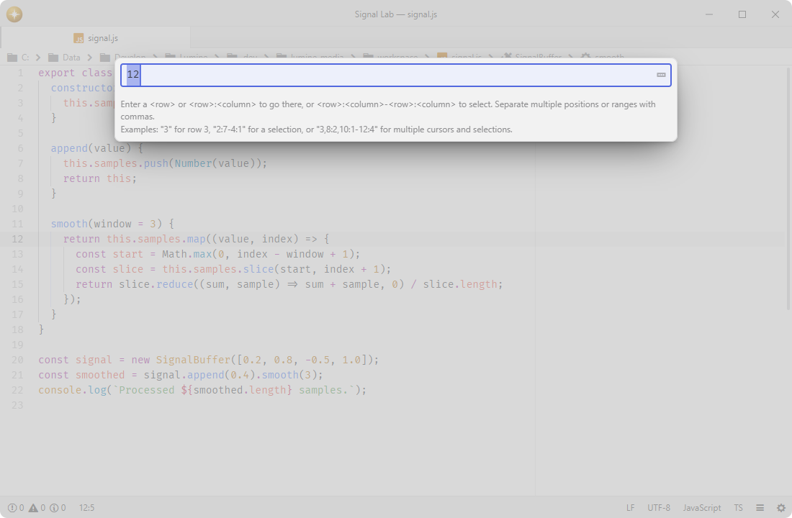

# go-to-line

Show the cursor position and jump to lines or ranges.

Fork of [pulsar-edit/pulsar](https://github.com/pulsar-edit/pulsar) (`packages/go-to-line`).

## Features

- **Line navigation**: moves the cursor to the line number you type.
- **Column support**: accepts `line:column` input to place the cursor at a specific column.
- **Range selection**: accepts `line:column-line:column` input to select from the first position to the second, following the direction you type.
- **Multiple cursors and selections**: accepts comma-separated positions and ranges, such as `3,8:2,10:1-12:4`, and makes the last item active.
- **Numeric input**: restricts entry to digits, colons, dashes, and commas for quick, error-free navigation.
- **Editor position**: shows the cursor line and column, selection size, and cursor count in the status bar; click it to open the prompt.
- **Liquid templates**: formats the status bar tile from a preset or a custom Liquid template.

## Installation

To install `go-to-line` search for it in the Install pane of the Lumine settings, or run the command `lumine --install lumine-code/go-to-line`.

## Commands

Commands available in `lumine-text-editor:not([mini])` and `.go-to-line`:

- `go-to-line:toggle`: open the prompt for the editor where the command was dispatched, or close its existing prompt. The prompt keeps that editor as its target until it closes.

Row-only navigation scans whitespace in bounded chunks and yields while traversing unusually long prefixes. Editing the document, entering a newer destination or cancelling the prompt discards pending navigation. One input accepts at most 2,000 destinations and 65,536 characters; exceeding either limit leaves the selections unchanged.

## Configuration

The position tile is rendered from a Liquid template. Pick a preset in the Settings view, or set `Status Bar Template` to `Custom` and edit `Custom Status Bar Template`. The template receives `start.row`, `start.col`, `end.row`, `end.col`, `lines`, `chars`, and `n`; `start` is the selection anchor and `end` is the cursor, so the pair follows the selection direction.

Turn `Show In Status Bar` off to use the command without displaying the tile.

Left-click the position tile to open Go to Line, or right-click it to choose the same action from its context menu.

## Services

- `status-bar`: consumed to add the editor-position tile to the left side of the status bar.

## Contributing

Got ideas to make this package better, found a bug, or want to help add new features? Just drop your thoughts on GitHub. Any feedback is welcome!
